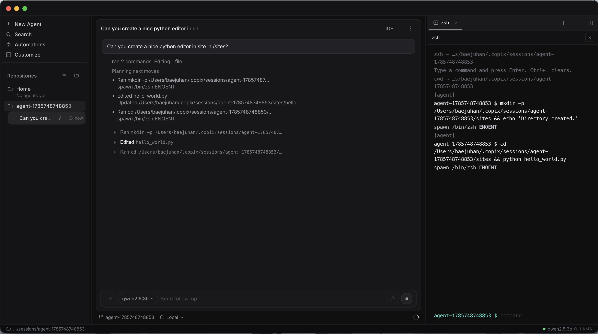

<p align="center">

</p>

<h1 align="center">Copix</h1>

<p align="center">A local coding agent on Ollama. Your files stay on your machine.</p>

<p align="center">
	<a href="#download"><strong>Download</strong></a>
	&nbsp;·&nbsp;
	<a href="https://copixdev.github.io"><strong>Website</strong></a>
	&nbsp;·&nbsp;
	<a href="https://github.com/copixdev/copix-cli"><strong>CLI</strong></a>
</p>

## Download

**Copix Desktop v4.4.0.** Install [Ollama](https://ollama.com) first. The default model is `qwen2.5:3b`.

| Platform | Installer |
| --- | --- |
| macOS (Apple Silicon) | [`Copix-4.4.0-macOS-arm64.dmg`](https://github.com/copixdev/copix-desktop/releases/download/v4.4.0/Copix-4.4.0-macOS-arm64.dmg) |
| Windows (x64) | [`Copix-4.4.0-Windows-x64.exe`](https://github.com/copixdev/copix-desktop/releases/download/v4.4.0/Copix-4.4.0-Windows-x64.exe) |
| macOS (Apple Silicon), 4.3.0 | [`Copix-4.3.0-macOS-arm64.dmg`](https://github.com/copixdev/copix-desktop/releases/download/v4.3.0/Copix-4.3.0-macOS-arm64.dmg) |
| Windows (x64), 4.3.0 | [`Copix-4.3.0-Windows-x64.exe`](https://github.com/copixdev/copix-desktop/releases/download/v4.3.0/Copix-4.3.0-Windows-x64.exe) |

Checksums: [`release/SHA256SUMS.txt`](release/SHA256SUMS.txt). Release page: [v4.4.0](https://github.com/copixdev/copix-desktop/releases/tag/v4.4.0).

## Desktop

<p align="center">

</p>

<p align="center"><a href="assets/demo.mov"><strong>Watch the demo</strong></a></p>

## Desktop 4.5.0

4.5.0 rebuilds the desktop shell on [Code - OSS](https://github.com/microsoft/vscode) (`microsoft/vscode` 1.141.0, MIT). The Copix agent is a built-in extension: chat on the right, inline diffs with Accept and Reject, Ollama and OpenRouter, and the OpenRouter key in the OS keychain. The gallery is Open VSX. Telemetry is off. `LICENSE.txt` and `ThirdPartyNotices.txt` from Code-OSS stay in the app. Codicons are credited in `code-oss/NOTICE.md`.

The macOS disk image volume name is `Copix 4.5.0`. Installers are attached to a draft GitHub Release by `.github/workflows/desktop-v4.5.0.yml` when that workflow is run by hand. This branch does not publish the release.

```bash
git clone --depth 1 --branch 1.141.0 https://github.com/microsoft/vscode.git code-oss/src
python3 -m pip install pillow
python3 code-oss/prepare.py --src code-oss/src
```

Then, from `code-oss/src`, with Node 24.18.0: `npm ci` and the `vscode-darwin-arm64` or `vscode-win32-x64` gulp task.

## Build from source (4.4 studio)

Requires [Node.js 18+](https://nodejs.org). Both apps package with electron-builder.

macOS, from `macOS/studio`:

```bash
npm install
npm run dist
```

`npm run dist` runs electron-builder and writes the DMG under `macOS/studio/release/`.

Windows, from `Windows/studio`:

```bash
npm install
npm run dist
```

`npm run dist` runs electron-builder and writes the installer under `Windows/studio/release/`.
